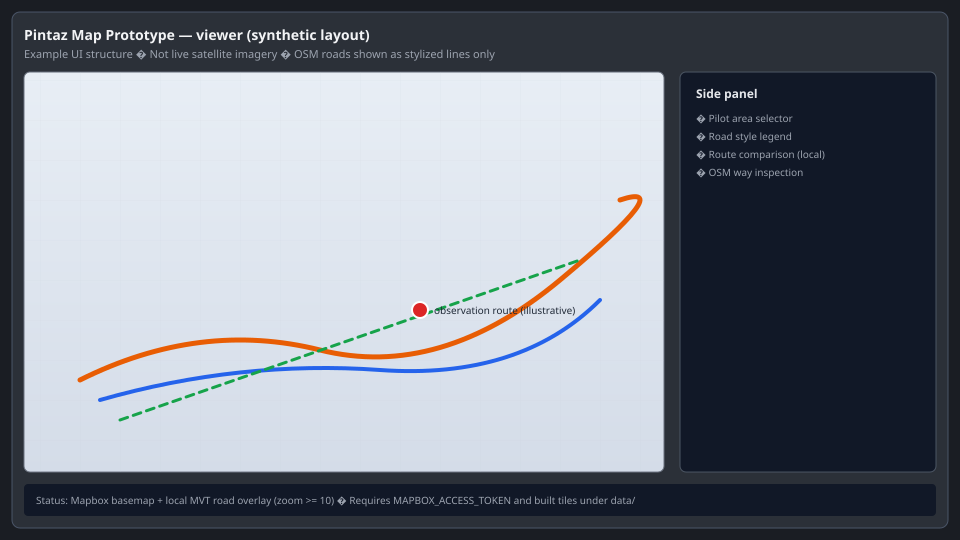

# Pintaz Map Prototype

**Pintaz Map Prototype** is a research and engineering workspace for a small **Mapbox-based road map** (Malaysia pilot areas) plus **offline pipelines** that compare vehicle observations to OSM, audit Maps Read exports, and screen routes for **future geometry work** on unknown-lane roads. It is **not** a verified lane-counting or OSM auto-enrichment product.



*Figure 1 — **Synthetic UI layout** (illustration only). The real app uses your Mapbox token and locally built OSM vector tiles; this image contains no satellite imagery, traces, or private coordinates.*

---

## Quick start

**Minimum to run the web UI** (map may show basemap only until tiles are built):

```bash
git clone https://github.com/danyalrs/pintaz-map-prototype.git
cd pintaz-map-prototype
npm install
cp .env.example .env    # Windows: copy .env.example .env
```

Edit `.env`:

```env
MAPBOX_ACCESS_TOKEN=pk.your_public_mapbox_token_here
```

```bash
npm start
```

Open **http://127.0.0.1:3901**

| Step | Command | Data required |
|------|---------|----------------|
| Install deps | `npm install` | None |
| Configure map | `.env` with `MAPBOX_ACCESS_TOKEN` (`pk.` only) | Mapbox account (**required for basemap**) |
| Run viewer | `npm start` | Opens UI; overlay needs `data/tiles/` |
| Public tests | `npm run test:public` | No private data |
| Full road overlay | `npm run download:osm` → `extract:roads` → `build:tiles` | ~GB disk; see [docs/DATA_PIPELINE.md](docs/DATA_PIPELINE.md) |
| Unit tests (subset) | `npm test` | Many tests skip without local bundles |
| Road data check | `npm run validate:data` | Built `data/processed` + `data/tiles` |

Optional Maps Read API scripts need `MAPS_READ_TOKEN` and local `data/maps-read/` caches — **not included** in this repository.

---

## Bukit pilot — final screening results

Read-only synthesis from completed Phase 3 work. **No lane counts inferred; no OSM edits.**

| Metric | Count |
|--------|------:|
| Relevant routes screened | **1,597** |
| Routes qualified for future geometry | **198** |
| Qualified route × unknown-way pairs (before geometry gates) | **1,123** |
| Pairs reaching geometry evaluation | **430** |
| Future-geometry candidate pairs (after gates) | **90** |
| Unknown-lane roads with ≥1 candidate pair | **46** |

All **198** qualified saved lane-edge exports audited in development were **point-only** (no ordered polylines). Details: [reports/public/final_phase3_summary.json](reports/public/final_phase3_summary.json) and [PHASE3_GEOMETRY_SOURCE_CAPABILITY_AUDIT.md](reports/public/PHASE3_GEOMETRY_SOURCE_CAPABILITY_AUDIT.md).

---

## What is implemented vs experimental vs future

### Implemented

- Map viewer (Express + Mapbox GL + local MVT road layers)
- OSM download → extract → tilemaker pipeline
- Route comparison / local explorer tooling (when local bundles exist)
- Maps Read route enrichment discovery Phases 0–3 **libraries and scripts**
- Point-only signature calibration and route-aware qualification audits
- Read-only report builders and public redacted aggregates under [`reports/public/`](reports/public/)

### Experimental (research code)

- Polyline adapter and lane-enrichment algorithm core (**synthetic fixtures**; rejects point-only Maps Read exports)
- Geometry v2 / v3 diagnosis and robustness experiments
- Cross-section lane **candidate** logic — **not** validated for OSM unknown-way lane counts

### Future / not shipped

- Ordered **lane-boundary** and **road-edge** polylines from Maps Read ([export contract](src/lib/maps-read-lane-geometry-capability-audit/export-contract.js))
- Cross-section lane counting on unknown OSM ways
- OSM lane tag writes; raw qlog path ([FUTURE_QLOG_INTEGRATION.md](docs/FUTURE_QLOG_INTEGRATION.md))

**Do not** treat `lane_point`, `edge_point`, `lane_index`, or green markers as physical lane inventory.

---

## Documentation map

| Document | Purpose |
|----------|---------|
| [PROJECT_HANDOVER.md](PROJECT_HANDOVER.md) | Operator handover, regen commands, exclusions |
| [docs/ARCHITECTURE.md](docs/ARCHITECTURE.md) | Folders, pipelines, module roles |
| [docs/DATA_PIPELINE.md](docs/DATA_PIPELINE.md) | OSM download and tiles |
| [docs/PILOT_AREA.md](docs/PILOT_AREA.md) | Pilot bbox and areas |
| [docs/PUBLICATION_MANIFEST.md](docs/PUBLICATION_MANIFEST.md) | What this public repo includes / excludes |
| [reports/public/FINAL_PHASE3_RESULTS.md](reports/public/FINAL_PHASE3_RESULTS.md) | Final Phase 3 narrative |
| [reports/public/top_20_future_geometry_pairs.md](reports/public/top_20_future_geometry_pairs.md) | Top candidate pairs (redacted) |

---

## Repository layout (short)

```
src/server.js, src/public/     Web map
src/lib/                       Pipelines, discovery, enrichment research
scripts/                       CLI entrypoints
tests/                         Node test suite + fixtures
config/                        Map and tile styles
docs/                          Pilot and pipeline notes
reports/public/                Redacted aggregate reports only
```

---

## Tests

| Command | What it checks |
|---------|----------------|
| **`npm run test:public`** | Curated tests using only repo code + fixtures (see [docs/TESTING.md](docs/TESTING.md)) |
| **`npm test`** | Full suite; many tests need local `data/` trees or comparison bundles |
| **`npm run validate:data`** | OSM extract + road tiles on disk (not included in public repo) |

```bash
npm run test:public
node --check src/server.js
```

---

## What you see in the browser

| Configuration | What loads |
|---------------|------------|
| `npm start` only (no `.env` token) | Server and page shell; **Mapbox basemap will not render** until `MAPBOX_ACCESS_TOKEN=pk.…` is set |
| Valid `pk.` token, no `data/tiles/` | Mapbox basemap; **no coloured OSM road overlay** (status banner explains missing tiles) |
| Token + built tiles | Basemap + styled local OSM roads at zoom ≥ 10 |

---

## Licensing

Map data © OpenStreetMap contributors. Mapbox © Mapbox. **No licence is currently provided.**
